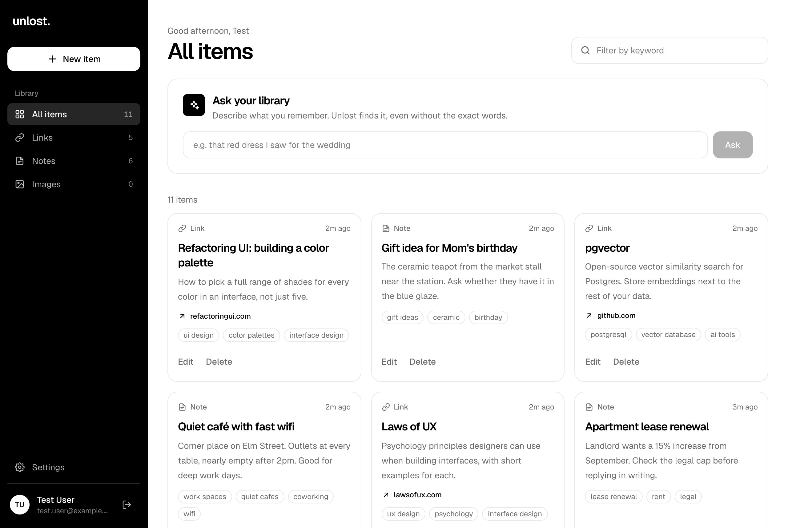
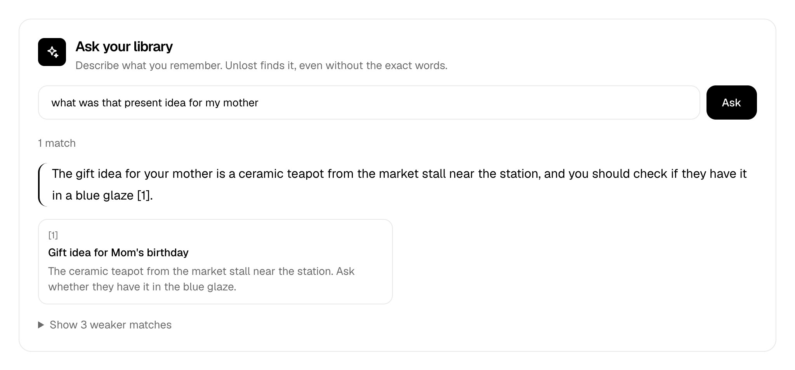

# Unlost

A personal "save it, find it later" tool. Drop in links, notes, and screenshots the moment they catch your attention, then find them again weeks later by describing what you remember — not by scrolling back through everything you've saved.



## Why this exists

Bookmark folders and screenshot camera rolls are where things go to be forgotten. Unlost is built around one idea: you shouldn't have to remember *where* you saved something, only roughly *what* it was about. That's the whole point of the "Ask your library" search — it's not keyword matching, it's semantic recall.



Ask something close to what you actually remember, and it finds the right item and answers using only what you've saved — it says so plainly when nothing matches, instead of guessing.

## What's technically interesting here

- **Grounded, cited RAG search.** A saved item's title, description, and image caption are embedded with the Gemini Embedding API and stored in Postgres via `pgvector`. A question is embedded the same way and matched by cosine similarity, with a similarity floor so unrelated items are dropped. Writing an answer is a separate, opt-in step: the matches are handed to Gemini with an explicit instruction to answer only from what's given, cite the item number, and say so if nothing actually answers the question.
- **Bring your own key, so it stays free for everyone.** Each user adds their own free Gemini API key (encrypted at rest with AES-256-GCM). The app never spends shared quota, one heavy user can't exhaust it for others, and there's nothing to pay for. Without a key — or when a key's quota runs out — search falls back to a Postgres keyword search instead of failing.
- **Quota-aware by design.** A search costs one embedding request; the AI answer only runs when asked. Tagging and image captioning share one generation request. Images are resized and compressed in the browser before upload.
- **Image recall without exposing AI text to the user.** Upload a screenshot and leave the description blank — Gemini's vision model writes a caption for it. That caption is never shown in the UI; it lives in a field used only for embedding and tag generation, so what you see is what you wrote, not a paragraph the model invented.
- **Background enrichment, not a blocking save.** Embedding and tagging happen after the response is already sent (via Next.js's `after()`), so saving an item stays fast instead of waiting on a live Gemini round trip.
- **Single-service architecture, on purpose.** Frontend and API routes live in the same Next.js app rather than a separate backend — a deliberate choice after hitting real third-party-cookie issues on a two-service setup in an earlier project. Same-origin sidesteps that whole class of bug.
- **Genuinely zero ongoing cost.** Users' own free Gemini keys, a free-tier Postgres instance, free hosting, no paid services. The stack was chosen around that constraint, not despite it.
- **Hardened for real users.** Invite-only sign-up, Postgres-backed rate limits, request size limits, a per-request nonce Content-Security-Policy, timing-safe login, account deletion, and unit tests that mock Gemini so the suite spends no quota (`npm test`).

## Stack

Next.js 16 (App Router, Route Handlers) · TypeScript · Prisma · PostgreSQL + pgvector · Google Gemini API (embeddings, RAG, vision captioning) · Tailwind CSS

## Running it locally

```bash
git clone https://github.com/burcakbilir/unlost.git
cd unlost
npm install

# Postgres with the pgvector extension
docker compose up -d

cp .env.example .env
# then fill in .env (see the comments in .env.example):
#   SESSION_SECRET   — openssl rand -base64 48
#   ENCRYPTION_KEY   — openssl rand -base64 32

npx prisma migrate dev
npm run invites -- 1   # prints an invite link
npm run dev
```

Open the invite link, create an account, then add your Gemini key (free, from https://aistudio.google.com/apikey) under Settings.

## Deploying (free: Vercel + Neon)

1. **Database:** create a free project on [Neon](https://neon.tech). Copy its connection string (use the pooled one). pgvector is enabled by the first migration.
2. **App:** import the repo on [Vercel](https://vercel.com) (Hobby plan). Set **Build Command** to `npm run build:deploy` so migrations run on each deploy.
3. **Environment variables** on Vercel: `DATABASE_URL`, `SESSION_SECRET`, `ENCRYPTION_KEY` — generate new production values, never reuse local ones. Keep `ENCRYPTION_KEY` safe: if it changes or is lost, saved Gemini keys can't be decrypted and users must re-enter them.
4. **Invites:** from your machine, `DATABASE_URL=<neon url> APP_URL=<your vercel url> npm run invites -- 5`.

Vercel's Hobby plan is for non-commercial use. Neon's free tier has limited storage; images are compressed before upload to stretch it.

## Project structure

Feature-based, not layer-based — `src/app/**` holds only routing, everything else lives under `src/features/<name>/` and `src/lib/`. Auth is an httpOnly JWT cookie, checked in `src/proxy.ts` for route protection and verified server-side on every API call.
